# Arquitectura del ETL Typack

Cómo funciona el proceso después de las fases 0, 1, 2, 3, 4 y 5.

- **Fase 0** — estabilización: esquema canónico, escritura atómica, helpers unificados.
- **Fase 1** — ventana móvil de 35 días con particionado por mes operativo.
- **Fase 2** — landing inmutable de la respuesta cruda y manifiesto de corridas.
- **Fase 3** — CDC y libro de auditoría de reasignaciones.
- **Fase 4** — publicación del libro junto al consolidado y reasignaciones en el
  reporte semanal.
- **Fase 5** — resiliencia de red, estado por línea y control del orquestador.

> De la fase 4 queda un resto: el transformer sigue leyendo los CSV de las
> particiones en vez del estado vigente. No bloquea nada —la clave de unión ya
> viaja en la fila— pero es la puerta de entrada a la discusión de DuckDB.

---

## 1. El problema que resuelve

La API de MT Solutions no entrega un hecho inmutable: entrega el **estado actual**
de la sábana en el instante de la consulta. Un supervisor puede reclasificar una
detención días después del evento, y la plataforma además recalcula bloques de
tiempo hacia atrás.

Medido sobre dos extracciones reales de los mismos días, separadas por 14 días:

| Fenómeno | Magnitud |
|----------|----------|
| Segmentos que cambiaron de código | 34 de 5.268 (0,65 %) |
| Segmentos que se volvieron a cortar | 147 |
| Cobertura perdida por línea | −44 h (EXT_16 llega a −147,6 h) |
| Demora de las reasignaciones | entre 15 y 20 días tras el evento |

El proceso anterior descargaba el mes calendario en curso y **sobrescribía** el
CSV, de modo que cada corrida borraba la versión anterior sin dejar rastro.

---

## 2. Vista general

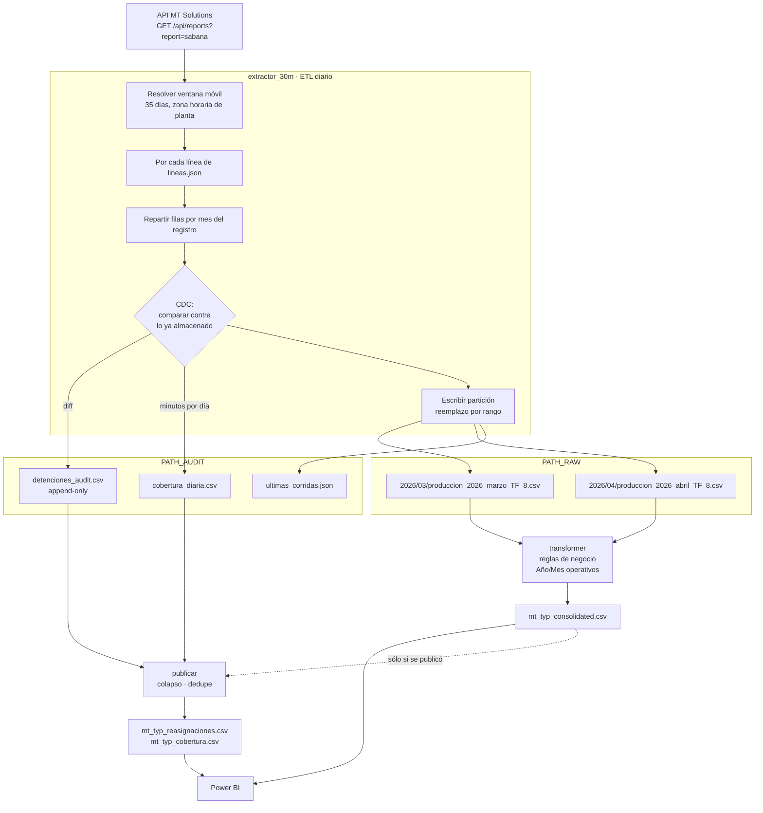

El orquestador `scripts/run_daily_etl.py` encadena extractor y transformer,
registra logs y envía alertas por correo.

---

## 2.bis Dos espacios de tiempo

Antes de seguir hay que fijar un concepto que atraviesa todo el pipeline: la
API **recibe** los parámetros en UTC y **devuelve** los timestamps en el reloj
de planta.

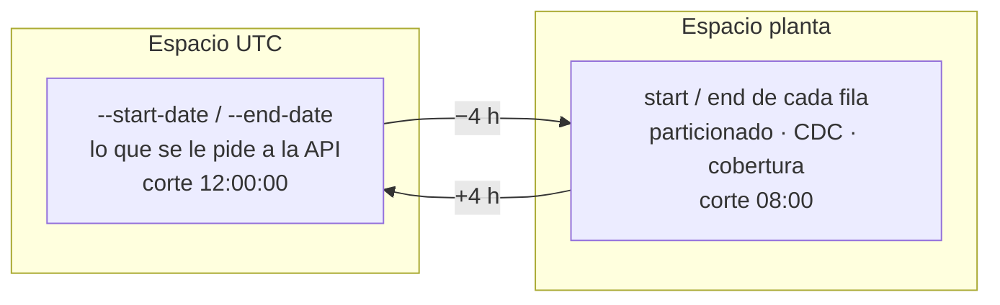

El reloj de la API **no es un desfase fijo**. Es hora chilena, pero el
servidor del proveedor cambia de hora con las reglas que Chile usó **entre 2016
y 2018** (verano del 2º domingo de agosto al 2º domingo de mayo), no con las
vigentes desde 2019 (1er sábado de septiembre al 1er sábado de abril). La
planta, en cambio, trabaja en hora local real y sus turnos empiezan siempre a
las 08:00/18:00/22:00.

Los dos relojes coinciden ~43 semanas al año y difieren en una hora en las dos
ventanas en que uno ya cambió y el otro no:

    1er domingo de abril  ->  2º domingo de mayo         (reloj API +1 h)
    2º domingo de agosto  ->  1er domingo de septiembre  (reloj API +1 h)

Verificado sobre 340.055 filas de 2024-2026: los cortes de turno saltan de
08:00 a 09:00 exactamente en esas cuatro fechas, los tres años. El testigo es
el campo `turn` que manda la propia API, porque el proveedor lo asigna con la
hora real de la planta: contrastado contra la hora local, coincide en el
99,99 % de las filas con la conversión de `date_utils.a_local()`, y en el
90 % de las ventanas de desfase sin ella.

Consecuencias prácticas:

- `a_local()` es obligatorio antes de aplicar cualquier regla de turno. El
  transformer lo aplica una vez, al leer el raw, y de ahí para abajo todo está
  en hora local.
- El raw **no** se corrige: guarda lo que el proveedor dijo, y la identidad de
  un segmento en el libro de auditoría es `sha1(devid + start + end)` con esos
  valores.
- `scripts/verificar_horario.py` mide esa coincidencia y falla bajo el 99,5 %.
  Es el detector de que el proveedor movió su reloj otra vez.

---

## 2.ter El día operativo

El negocio no trabaja en días de calendario sino en turnos de 24 h que van de
corte a corte. El corte es `12:00:00 UTC`, que en planta son las `08:00`, que es
el cambio de turno TD/TN de `config/horarios.json`.

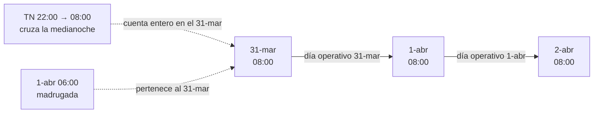

De ahí se sigue el **mes operativo**: del día 1 en el corte al día 1 del mes
siguiente en el corte.

| Registro | Mes operativo |
|----------|---------------|
| `2026-03-31 22:00` | marzo |
| `2026-04-01 00:00` | marzo |
| `2026-04-01 06:00` | **marzo** |
| `2026-04-01 07:59` | marzo |
| `2026-04-01 08:00` | abril |
| `2027-01-01 03:00` | diciembre 2026 |

El criterio es el mismo en las dos puntas del pipeline: el extractor decide en
qué archivo va cada registro y el transformer calcula `Año`, `Mes` y
`Dia_Operativo` con la misma regla. Por eso **todas las filas del archivo de
marzo dicen `Mes = 3`**, sin excepción.

Un registro que cruza la medianoche, como un turno de noche `22:00 → 04:33`,
es **un solo registro**, con su producción y su hora de término reales, contado
entero en el día operativo en que empezó.

---

## 3. La ventana móvil

### Por qué móvil y no mensual

El extractor mensual cortaba la cola el día 1 de cada mes: una detención del 28
de marzo reclasificada el 5 de abril **nunca se volvía a consultar**. La ventana
móvil no tiene ese borde.

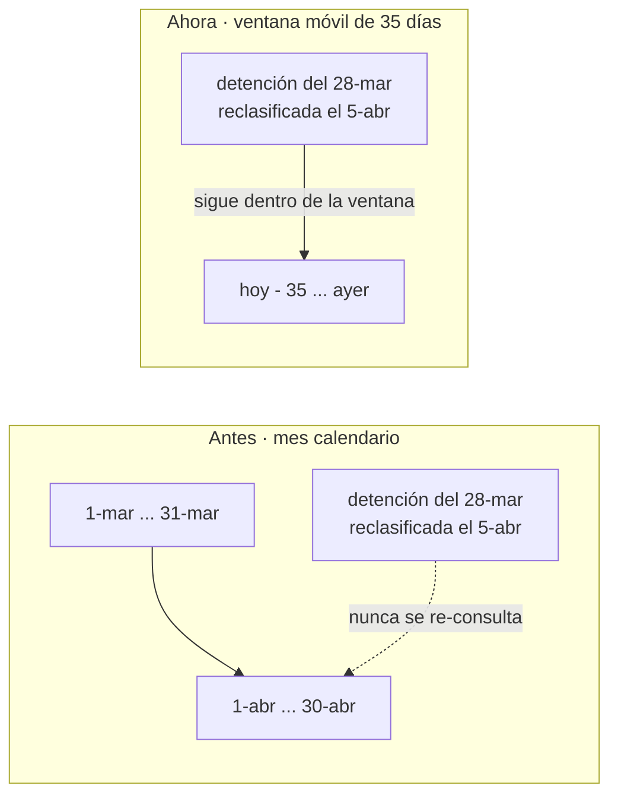

### Cómo se calcula

```
end   = el último corte ya cumplido      (12:00:00 UTC)
start = end - días                       (12:00:00 UTC)
```

`días` viene de `EXTRACTOR_WINDOW_DAYS` (default 35): 30 de ventana observada
más 5 de holgura para no perder el borde si una corrida falla.

Ambos extremos caen en el corte, así que la ventana son siempre N turnos
completos de 24 h y **nunca incluye un turno a medio andar**. Si la corrida se
ejecuta antes de las 12:00 UTC, el fin es el corte del día anterior.

Ejemplo: a las 14:30 UTC del 3 de abril, con `--days 35`, la ventana va de
`2026-02-27 12:00:00` a `2026-04-03 12:00:00` en UTC, que en los datos es de
`2026-02-27 08:00` a `2026-04-03 08:00`.

---

## 4. Particionado por mes operativo

Una ventana de 35 días cruza fin de mes, así que una misma corrida escribe en
dos carpetas. La partición la decide el **mes operativo de cada registro**, no
la fecha de la corrida ni el mes de calendario.

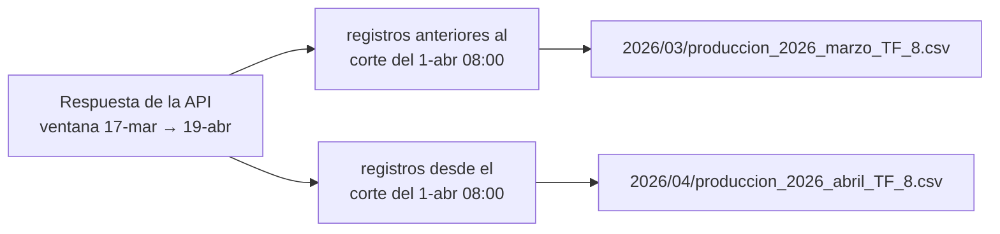

El turno de noche del 31 de marzo, que corre hasta las 08:00 del 1 de abril,
queda entero en el archivo de marzo.

Las particiones se recorren **según la ventana, no según los datos recibidos**:
un mes en que la línea no produjo nada igual se visita, para que el reemplazo
por rango borre lo que la API ya no reporta.

### Reemplazo por rango

Escribir el archivo de marzo con lo que devuelve la API destruiría del 1 al 16,
que quedan fuera de la ventana. Por eso sólo se reemplaza el tramo cubierto:

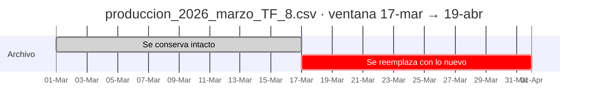

### Decisión fila por fila

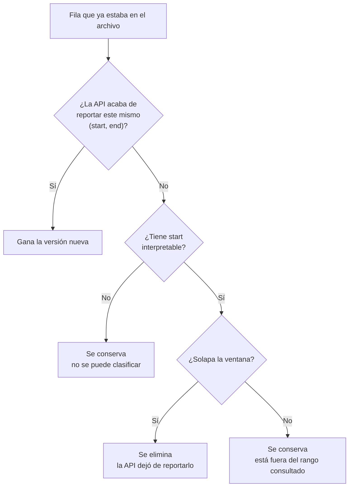

La primera pregunta no es cosmética. La API devuelve segmentos que **empiezan
antes** del inicio de la ventana (aparentemente el turno completo que contiene
el borde). Sin esa regla, la copia vieja se conservaba y la nueva se agregaba al
lado: cinco re-extracciones idénticas hacían crecer el archivo de 744 a 768
filas, y en producción crecería todos los días en todas las líneas.

### Garantías

- Una línea que **falla no escribe nada**: sus archivos quedan byte a byte igual.
- El archivo nunca acumula dos copias del mismo `(start, end)`.
- Toda escritura es atómica: se escribe un `.tmp` junto al destino y recién al
  cerrar se hace `os.replace()`. Importa porque el destino es una unidad de red.

---

## 4.bis El landing inmutable

Antes de tocar nada, la respuesta de la API se guarda tal como llegó. El libro
de auditoría dice *qué* cambió y *cuándo*, pero se construye comparando el CSV
ya escrito contra la respuesta nueva: sin una copia cruda no hay a qué volver
cuando haya que peritar una discrepancia.

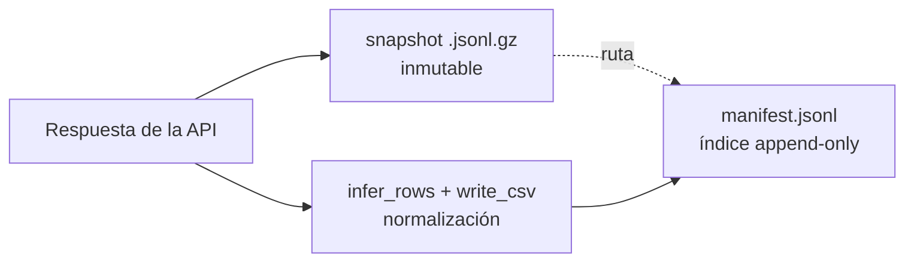

**Un archivo por corrida y línea**, particionado por día:

```
<PATH_SNAPSHOTS>/YYYY/MM/DD/{run_id}_{devid}.jsonl.gz
   primera línea : el sobre (run_id, ventana, devid, http_status, error)
   líneas siguientes : un registro crudo por línea, sin normalizar
```

Propiedades que lo hacen servir como evidencia:

- **Nunca se sobrescribe.** Escribir sobre un snapshot existente es un error, no
  una actualización.
- **Es anterior a la normalización.** El CSV rellena las columnas que la API
  omite y convierte los decimales a coma; el snapshot no hace ninguna de las dos.
- **Las corridas fallidas también quedan**, con el error y el código HTTP en el
  sobre. Una corrida que falló es justamente la que interesa reconstruir.

El **manifiesto** es el índice: una línea JSON por (corrida, línea) con estado,
filas, cobertura, cambios detectados y la ruta de su snapshot. No se rota, así
que sigue diciendo qué hubo aunque el contenido ya se haya purgado.

Medido sobre una corrida real: 11 snapshots, **188 KB** comprimidos (4 % del
crudo), unos **17 MB** por los 90 días de retención.

---

## 5. El CDC

Antes de escribir cada partición, se compara lo que la API devuelve contra lo
que el archivo ya tenía. Ese diff **es** el libro de auditoría.

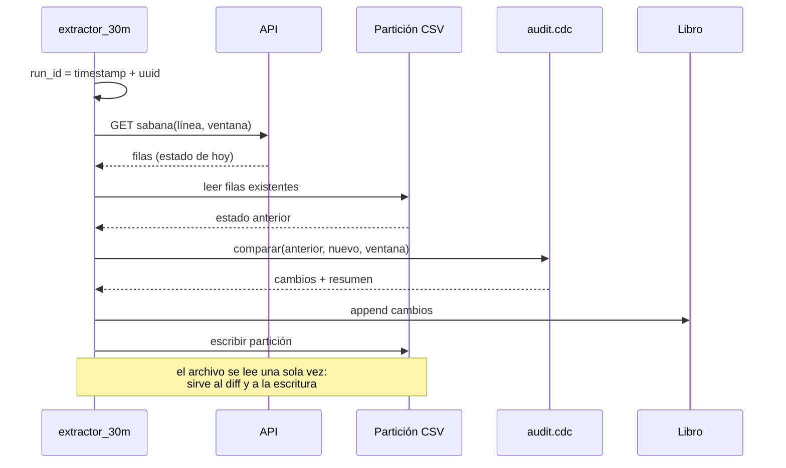

### Identidad de un segmento

La API no devuelve ningún `id`, así que la identidad se deriva del segmento
físico:

```
record_key = sha1(devid | start | end)
```

Verificado sobre 26.776 filas reales:

| Clave candidata | Colisiones | Veredicto |
|-----------------|-----------|-----------|
| `start` | 45 (0,17 %) | Insuficiente: una micro-parada de 0 min convive con una detención de 5,8 min en el mismo instante |
| `start + end` | 0 | **Única** |

### Dos huellas

Separan lo que se audita de lo que sólo se registra:

| Huella | Campos | Para qué |
|--------|--------|----------|
| `assignment_hash` | los 7 `code_*` | Si cambia, alguien reclasificó la detención |
| `content_hash` | los 7 `code_*` + 12 de contexto | Si cambia sin que cambie el otro, se editó un comentario, usuario o producción |

**Normalización.** Un lado de la comparación viene de la API (floats, ints,
claves ausentes) y el otro de un CSV (todo texto, decimales con coma). Ambos se
normalizan con el mismo `format_value` del writer antes de calcular la huella.
Sin esto, `4.366666666666666` y `"4,366666666666666"` serían distintos y **toda
corrida marcaría todo como cambiado**.

### Clasificación

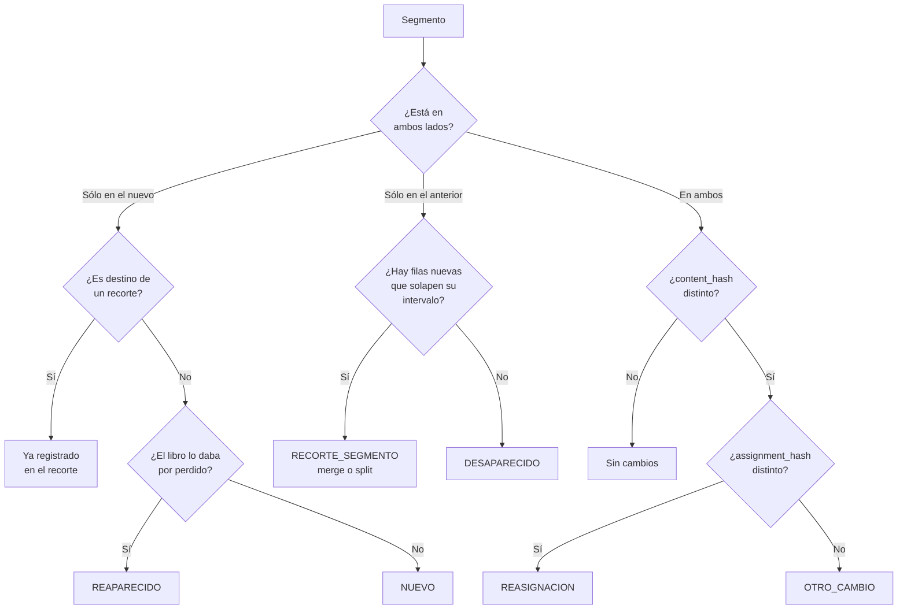

| Tipo | Se escribe al libro | Nota |
|------|--------------------|------|
| `REASIGNACION` | Sí | **El evento que se busca.** Una fila por campo modificado |
| `OTRO_CAMBIO` | Sí | Comentario, usuario o producción editados |
| `RECORTE_SEGMENTO` | Sí | Se registra el mapeo origen → destino |
| `DESAPARECIDO` | Sí | Alerta: la API dejó de reportarlo y nada lo reemplaza |
| `REAPARECIDO` | Sí | Una clave que el libro daba por perdida volvió |
| `NUEVO` | **No** | Un alta no es la mutación de un hecho conocido; en 35 días son cientos por línea y día. Se cuenta en el resumen. Activable con `registrar_nuevos=True` |

### Alcance de la comparación

Sólo se comparan los segmentos sobre los que la API es autoridad:

> la ventana consultada, **más** cualquier segmento que la respuesta traiga
> aunque caiga fuera de ella.

La primera condición evita cientos de falsos `DESAPARECIDO` por corrida: un
segmento fuera del rango no es un segmento borrado, es un segmento que no se
preguntó. La segunda evita que los segmentos del borde se cuenten como altas
nuevas en cada corrida.

### Por qué el orden no importa

La API no garantiza orden: dos extracciones idénticas devuelven las mismas filas
ordenadas distinto. La comparación se hace por `record_key` sobre diccionarios,
nunca por posición. Verificado: el par idéntico barajado produce 0 cambios.

---

## 6. Cobertura diaria

El CDC detecta cambios a nivel de registro. La cobertura los detecta a nivel
agregado, y hace falta porque **la pérdida de 44 h no aparece como
`DESAPARECIDO`**: los bloques "Periodo No Laboral" de 18:00→22:00 y 21:00→22:00
se solapan, así que el CDC los clasifica —correctamente— como
`RECORTE_SEGMENTO`. Lo que se pierde son los minutos.

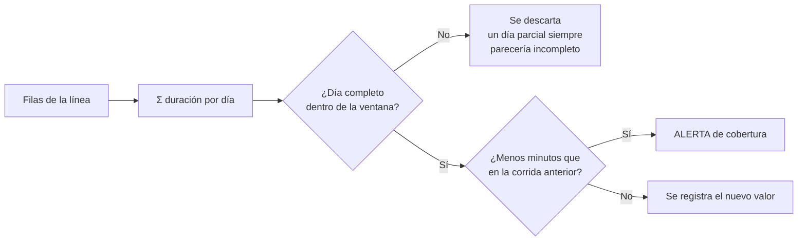

Sobre los datos reales de TF_5 detecta los 14 días afectados y cuantifica
exactamente −2.640 min. La tolerancia es de 1 minuto, para no alertar por
redondeos.

---

## 7. Archivos que produce

### Datos

```
PATH_RAW/{año}/{mes}/produccion_{año}_{mes_nombre}_{línea}.csv
```

Delimitador `;`, decimales con `,`, UTF-8 con BOM, y **esquema canónico fijo de
21 columnas**:

```
start, end, duration, device, line, plant, turn, order, sku, product,
format, production, code_description, code_u, code_f, code_t, code_l,
code_m, code_n, comments, user
```

La API omite las claves nulas; las columnas que falten se escriben vacías. Antes
la cabecera se armaba con la unión de claves presentes, y convivían archivos de
20 y de 21 columnas en la misma serie.

### Auditoría (`PATH_AUDIT`, default `data/audit`)

| Archivo | Contenido |
|---------|-----------|
| `detenciones_audit.csv` | Libro append-only. 17 columnas, una fila por campo modificado |
| `cobertura_diaria.csv` | `linea, devid, fecha, minutos, pct_cobertura, run_id, actualizado_en` |
| `ultimas_corridas.json` | `run_id` de la última corrida que escribió cada línea |

Columnas del libro:

```
record_key, devid, linea, maquina, start, end, duration,
detectado_en, dias_desde_evento,
run_id_anterior, run_id_actual,
tipo_cambio, campo, valor_anterior, valor_nuevo,
usuario_anterior, usuario_nuevo
```

`dias_desde_evento` es el eje del análisis: `detectado_en − start`. Sobre los
datos reales, las 34 reasignaciones se detectaron entre 15 y 20 días después del
evento, lo que confirma que 30 días es el corte correcto.

### Publicado para Power BI (`PATH_CONSOLIDATED`)

El libro vive en `PATH_AUDIT`, que el BI no lee. Estas tres tablas son lo único
que llega al reporte:

| Archivo | Grano | Contenido |
|---------|-------|-----------|
| `mt_typ_consolidated.csv` | Un segmento | El dato de producción, con `Record_Key` y `Reasignada` |
| `mt_typ_reasignaciones.csv` | Un código reasignado | El detalle del cambio: de qué código a cuál, cuándo y con cuánto retraso |
| `mt_typ_cobertura.csv` | Línea × día operativo | Minutos reportados y `Pct_Cobertura` |

Las escribe `audit/publicar.py`, que llama el orquestador **después** de que el
transformer publicó el consolidado. Si la transformación falló no se publican:
reasignaciones frescas junto a un consolidado viejo mostrarían en el BI cambios
sobre datos que no se actualizaron. El sidecar `mt_typ_consolidated.estado.json`
declara si se publicaron y cuántas filas salieron.

Columnas de `mt_typ_reasignaciones.csv`:

```
Record_Key, Linea, Maquina, Fecha_Hora_Inicio, Fecha_Hora_Termino, Duracion_min,
Detectado_En, Dias_Desde_Evento,
Campo, Cod_Anterior, Cod_Nuevo, Desc_Anterior, Desc_Nuevo,
Usuario_Anterior, Usuario_Nuevo, Run_Id
```

**Se publica el historial completo, sin ventana temporal.** Contra-intuitivo
para un archivo append-only, pero lo sostiene el volumen: el libro real de 174
filas queda en 14 una vez filtrado y colapsado. Una ventana sólo agregaría un
parámetro que discutir y huecos en el join.

Dos transformaciones separan el libro de lo publicado:

| | Libro | Publicado |
|---|---|---|
| Tipos de cambio | Los seis | Sólo `REASIGNACION` |
| Grano | Una fila por campo modificado | Una fila por código reasignado |
| `code_description` | Fila propia | Plegado en `Desc_Anterior`/`Desc_Nuevo` |
| Re-detecciones | Todas | Deduplicadas, se conserva la más antigua |

La deduplicación no es cosmética. `--output` y `--audit-dir` son flags
independientes del extractor, así que una corrida que escriba los datos en otro
lado vuelve a comparar contra el archivo viejo y registra la misma reasignación
otra vez: en el libro real eso ocurrió 6 veces sobre los mismos 14 segmentos. Se
deduplica por `(record_key, campo, valor_anterior, valor_nuevo)`, que no pierde
reclasificaciones genuinas —si el código cambia dos veces de verdad, el
`valor_anterior` de la segunda es el `valor_nuevo` de la primera.

### El modelo en Power BI

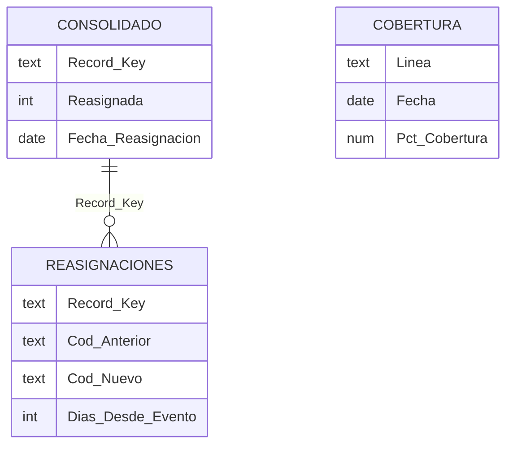

Relación **N:1** de `mt_typ_reasignaciones` a `mt_typ_consolidated` por
`Record_Key`, dirección de filtro simple. `Dias_Desde_Evento` es la medida del
retraso de asignación. `mt_typ_cobertura` no se relaciona por `Record_Key`: su
grano es línea × día, y se une por `Linea` + `Fecha` a la dimensión de calendario.

> **Al conectar por primera vez.** `traza.py` es posterior a buena parte de los
> datos históricos, así que las filas extraídas antes de que existiera no tienen
> `Record_Key` y el join va a mostrar huecos hasta que la ventana móvil de 35
> días pase por encima. Para datos más viejos hace falta una recarga con
> `extractor_mensual`. No rompe nada: son reasignaciones sin fila padre.

### Bitácoras (`PATH_LOGS`)

| Archivo | Columnas |
|---------|----------|
| `plan_<stamp>.csv` | `line; devid; start; end; output_path` |
| `results_<stamp>.csv` | `line; devid; start; end; rows; success; estado; cobertura_pct; error; detalle` |

`estado` reemplaza al viejo `success = rows > 0`, que confundía una línea
legítimamente detenida con un fallo:

| estado | Significado |
|--------|-------------|
| `OK` | La línea respondió y la cobertura no cayó |
| `SIN_DATOS` | La línea no reportó nada. Es un dato, no un error |
| `COBERTURA_BAJA` | Un día ya cerrado reporta menos minutos que antes |
| `TRUNCADO_SOSPECHOSO` | El conteo cae justo en un límite redondo del servidor |
| `RELOJ_INESPERADO` | `duration` no cuadra con el intervalo: el reloj del proveedor se movió donde el modelo no lo esperaba (`audit/reloj.py`) |
| `ERROR` | La descarga falló tras agotar los reintentos |

`RELOJ_INESPERADO` pesa más que `COBERTURA_BAJA` porque un reloj corrido
explica una cobertura rara, no al revés. No aborta la corrida: los datos son
los que el proveedor mandó y casi toda la ventana está bien; lo que avisa es
que hay que mirar el modelo temporal antes de confiar en el mes.

Se rotan a los `RETENCION_LOGS_DIAS` días (90 por defecto). El libro de
auditoría no se rota.

Ambos comparten la marca de tiempo de la corrida, de modo que el par se puede
aparear. `detalle` resume lo escrito por partición y los cambios detectados:

```
2026-03:14(+16 conservadas); 2026-04:19(+0 conservadas); cambios: reasignacion=2
```

---

## 8. Configuración

Todo vive en `.env`, cargado por `config/settings.py`. Los antiguos
`config/credenciales.json` y `config/config.json` quedaron obsoletos.

El corte del día operativo y el desfase del reloj del proveedor **no están
acá**: dependen de la fecha del dato y los calcula `date_utils` (fueron
`CORTE_OPERATIVO_UTC` y `OFFSET_PLANTA_HORAS` hasta el 2026-09-16, con cuatro
ediciones manuales al año).

| Variable | Default | Para qué |
|----------|---------|----------|
| `API_USER` / `API_PASS` | — | Credenciales de la API |
| `EXTRACTOR_WINDOW_DAYS` | `35` | Días operativos hacia atrás que re-extrae el ETL diario |
| `PATH_SNAPSHOTS` | `data/snapshots` | Landing inmutable y manifiesto |
| `RETENCION_LOGS_DIAS` | `90` | Días que se conservan las bitácoras plan_/results_ |
| `RETENCION_SNAPSHOTS_DIAS` | `90` | Días que se conserva la respuesta cruda |
| `ETL_MAX_LINEAS_FALLIDAS` | `2` | Líneas que pueden fallar antes de abortar la transformación |
| `PATH_RAW` | `data/raw` | Particiones de datos |
| `PATH_AUDIT` | `data/audit` | Libro de auditoría y cobertura |
| `PATH_PROCESSED` / `PATH_CONSOLIDATED` / `PATH_LOGS` | — | Salidas del transformer y bitácoras |

Las líneas siguen en `config/lineas.json` (11 líneas: 8 TF, 3 EXT) y los turnos
en `config/horarios.json`.

---

## 9. Operación

### Diaria

```bash
python scripts/run_daily_etl.py
```

Ejecuta `extractor_30m --no-progress`, luego `transformer --incremental` y, si
el consolidado quedó publicado, las tablas de auditoría para el BI. Registra
logs en `PATH_LOGS/scheduler/` y envía alerta por correo si algo falla.

### Manual

```bash
# ventana por defecto, todas las líneas
python -m src.typack_etl.extractor.pipelines.extractor_30m

# una línea, ventana de 60 días
python -m src.typack_etl.extractor.pipelines.extractor_30m --devid 1273 --days 60

# recarga histórica de un mes ya cerrado
python -m src.typack_etl.extractor.pipelines.extractor_mensual \
  --start-date "2025-11-01 00:00" --end-date "2025-11-30 23:59:59"
```

`extractor_mensual` quedó reservado a recargas históricas. También reemplaza
sólo el tramo declarado, así que una recarga parcial no borra el resto del mes.

### Qué imprime una corrida

```
Ventana móvil de 35 días: start=2026-03-17 00:00 end=2026-04-19 23:59:59
Particiones a escribir: 2026-03, 2026-04
run_id: 20260826_150835_66d8491d
...
--- Auditoría de cambios ---
Segmentos: 5516 recibidos, 101 nuevos, 5415 ya conocidos
Cambios: 34 reasignaciones, 0 otras ediciones, 147 recortes, 0 desaparecidos

Reasignaciones de código (34):
  EXT_14 2026-03-04 07:47:34 [20d] code_description: No asignado -> 09.- No planificado - Falta de Insumos
  ...
```

---

## 10. Mapa de módulos

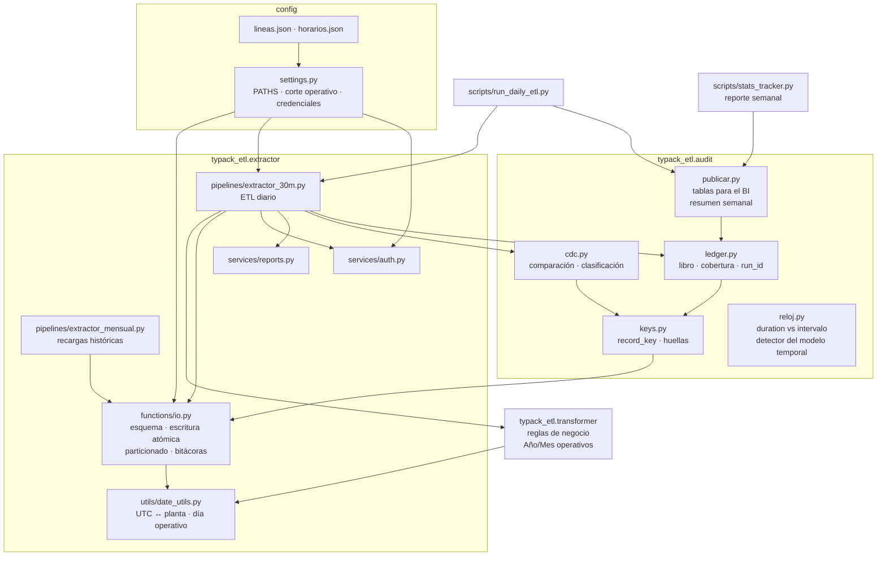

---

## 11. Qué garantiza y qué no

### Verificado

268 tests automatizados, sin red y sin tocar producción. Se corren con:

```bash
pytest
```

| Archivo | Cubre |
|---------|-------|
| `test_seguridad.py` | Que la propia suite no escriba en Drive ni salga a la red |
| `test_io.py` | Esquema canónico, escritura atómica, formato de valores, bitácoras |
| `test_fechas.py` | Corte operativo, conversión UTC ↔ planta, ventana móvil |
| `test_particionado.py` | Mes operativo y reemplazo por rango |
| `test_cdc.py` | Claves, huellas, clasificación e idempotencia |
| `test_auditoria.py` | Libro append-only, cobertura, run_id |
| `test_reloj.py` | Que `duration` confirme el modelo temporal, y que la alarma sea silenciosa |
| `test_traza.py` | Columnas de trazabilidad en la fila de datos |
| `test_landing.py` | Snapshots crudos, manifiesto y rotación |
| `test_publicacion.py` | Colapso por evento, deduplicación y resumen semanal |
| `test_resiliencia.py` | Reintentos, estado por línea y aislamiento de fallos |
| `test_orquestador.py` | Cuándo transformar, cuándo publicar y qué informa el reporte |
| `test_pipeline.py` | El extractor de punta a punta con la API simulada |
| `test_transformer.py` | Mes operativo, registros que cruzan medianoche, dtypes |

Las garantías que sostienen el diseño, verificadas contra los archivos reales
del repositorio:

| Garantía | Evidencia |
|----------|-----------|
| Idempotencia | Re-extraer lo mismo produce 0 filas de auditoría |
| Sin falsos positivos por orden | La respuesta barajada produce 0 cambios |
| Sin falsos positivos por formato | Floats de la API vs. CSV releído: 0 cambios |
| Detección real | Reproduce las 34 reasignaciones y los 147 recortes del análisis |
| Ventana correcta | Las reasignaciones caen todas dentro de los 30 días |
| Sin duplicados | 5 re-extracciones idénticas dejan el archivo igual |
| Aislamiento de fallos | Una línea que falla deja sus archivos byte a byte igual |
| Cobertura | Detecta los 14 días y los −2.640 min de TF_5 |
| Coherencia | Todas las filas de una partición declaran el mes de su carpeta |
| Publicación fiel | 6 re-detecciones × 2 campos se publican como 1 reasignación |
| Publicación condicionada | Si la transformación falla, no se publica auditoría |

Dos fixtures `autouse` en `conftest.py` hacen que las garantías no dependan de
que quien escriba el próximo test se acuerde: `sin_produccion` redirige todas
las rutas a un temporal y `sin_red` hace fallar cualquier llamada HTTP.

### Pendiente

| Límite | Fase que lo cierra |
|--------|--------------------|
| Las bitácoras del extractor mensual quedaron en subcarpetas sin rotar | limpieza manual |
| `plan_`/`results_` conviven con el manifiesto en vez de haber sido reemplazadas | seguimiento |
| El transformer sigue leyendo los CSV en vez del estado vigente | resto de 4 |
| Las filas anteriores a `traza.py` no tienen `Record_Key`: el join deja huecos | recarga histórica |
| La relación entre las tablas hay que armarla a mano en Power BI | modelado |

### Riesgo operativo conocido

El estado vive en CSV sobre Google Drive: sin bloqueo y con sincronización
asíncrona, dos corridas solapadas pueden corromperlo. La recomendación sigue en
pie: mover estado y auditoría a DuckDB o SQLite local al servidor, y publicar a
Drive sólo lo que Power BI lee.
